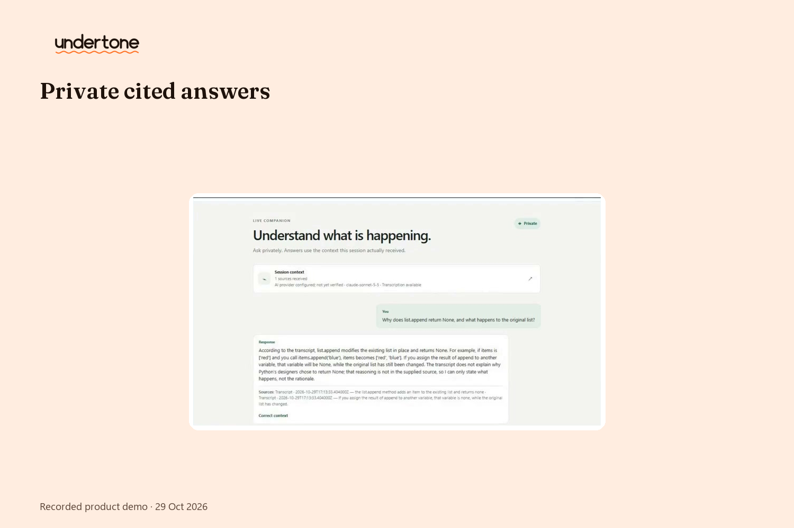
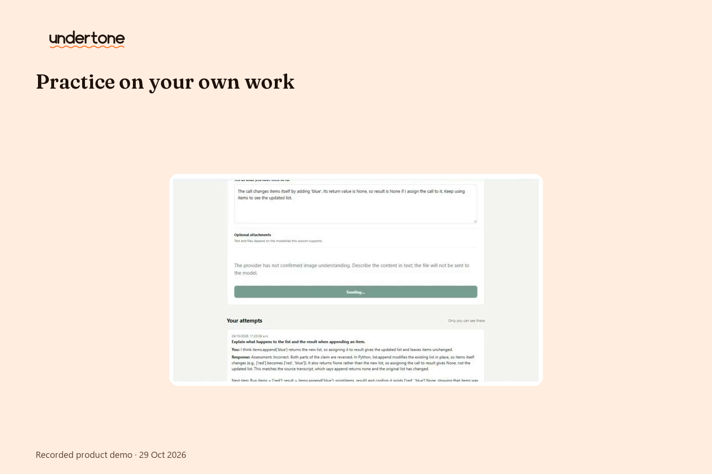
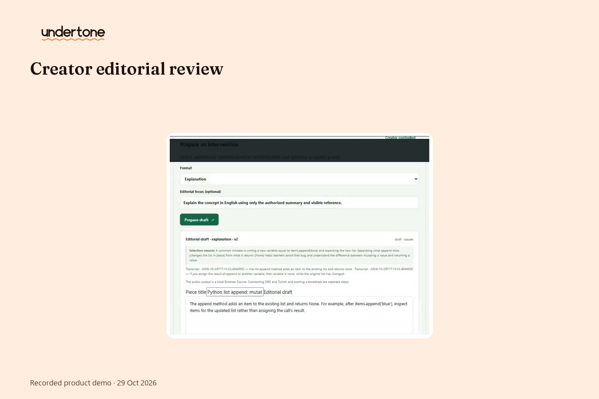
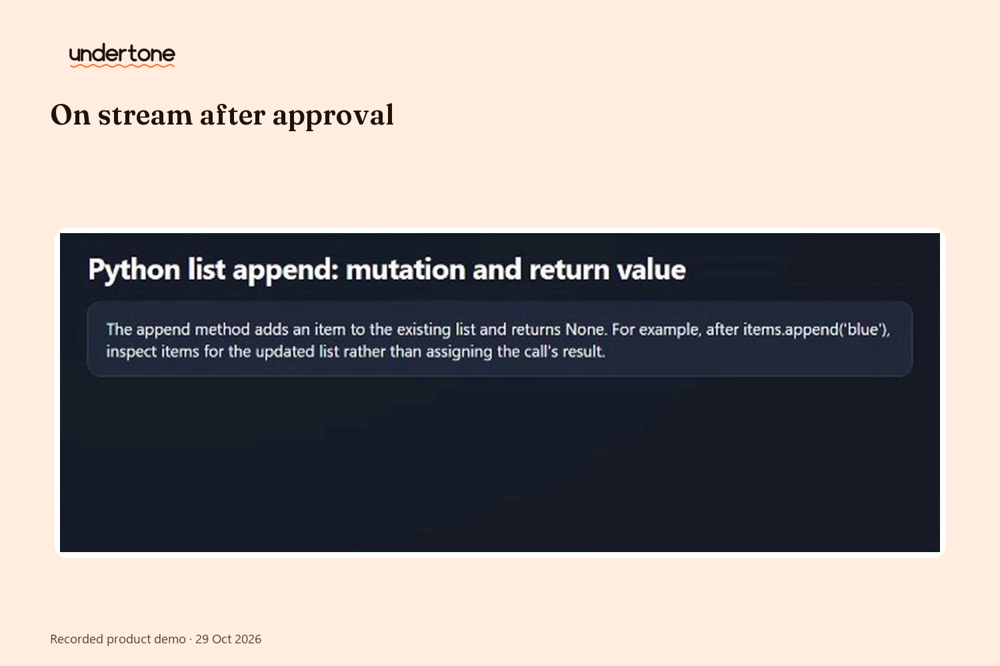

<div align="center">

# Undertone

**Hear what's underneath.**

*A private companion for every viewer — and a creator-controlled way to bring their voices on air.*

[Demo video](#)<!-- TODO Jonás: URL --> · [Devpost](#)<!-- TODO Jonás: URL --> · Built with OpenAI Codex

</div>

---

## The moment this is for

You join a stream twenty minutes late. The creator says *"so, like I explained before…"* — and you have no idea what they explained before. You could ask in chat. You won't. Two hundred people are watching, the question feels dumb, and by the time you type it the stream has moved on.

So you lurk. You half-understand. Eventually you leave.

**Undertone exists for that exact moment.** It gives every viewer a private way back into the conversation — and gives the creator full control over what, if anything, reaches the stream.

## What it does

Undertone is one loop, four steps:

1. **Understand privately.** Ask about anything the creator said. Answers cite the exact moments they come from — clickable timestamps, real context — and only you see them. When the evidence isn't there, Undertone says so instead of making something up.
2. **Practice on your own work.** Try the thing you just learned. Get feedback. Try again. Every retry stays linked to what you learned, so progress is visible, not vibes.
3. **Share only if you want to.** Sharing is a choice, with separate permissions for creator use and public use — and either can be revoked at any time.
4. **The creator decides what goes on air.** Contributions arrive grouped by theme, minority perspectives preserved. The creator picks one of six editorial formats, edits the draft, approves the *exact* version — and one click puts it on stream. One click takes it off.

Nothing reaches the stream without the creator's approval. Nothing leaves the viewer's screen without their consent. That's the whole deal.

## Why it's different

Captions make speech accessible — for everyone at once, one-way. Chat bots answer in public. Production tools serve the creator's workflow. **Undertone starts with the viewer who is lost**, and connects a loop nobody else connects: private understanding → voluntary contribution → creator editing → creator-approved presentation, live on Twitch.

The quiet insight: **private understanding is valuable even when the viewer never shares anything.** Most won't. That's fine. That was the point.

## See it live

> 🎬 **[3-minute demo](#)<!-- TODO Jonás: URL -->** — a real Twitch player, a real approved card appearing on stream, and how we built it with Codex.

| | |
|---|---|
|  |  |
|  |  |

## How it works

- **Server:** Python 3.12 — lean, local-first, no heavyweight framework.
- **Speech recognition:** faster-whisper running locally on CPU. The stream's audio is transcribed on your machine; it never leaves it.
- **AI provider:** configurable — Ollama by default for a fully local setup, Claude selectable when you want more muscle. Your stack, your call.
- **On-stream surface:** an OBS Browser Source rendering the approved card straight into the live Twitch player.
- **Client:** plain browser, no build step. Open it and it works.

```
viewer ──ask──▶ private companion ──cites──▶ stream moments
   │
   └──share (consent)──▶ creator panel ──approve──▶ OBS Browser Source ──▶ Twitch
```

## Run it locally

```powershell
# Python 3.12, from the repository root
$env:APP_PORT = '18765'
$env:APP_DATA_DIR = (Join-Path (Get-Location) 'data')
$env:APP_CLIENT_DIR = (Join-Path (Get-Location) 'client')
$env:APP_AI_PROVIDER = 'ollama'
py -3.12 -B -m server
```

Then open `http://127.0.0.1:18765/`. Full setup, packaging, and backup/recovery live in **[docs/](docs/OPERATIONS.md)** — this section stays short on purpose.

## Built with Codex

Undertone was built in scoped Codex CLI tasks: each assignment named its outcome and file ownership, a worker implemented and recorded focused checks in a handoff, and a coordinator reviewed the evidence before work continued — four workers max, one writer per file. The full process story is in **[BUILT_WITH_CODEX.md](BUILT_WITH_CODEX.md)**.

Product decisions stayed human, start to finish.

### Codex session IDs

The following sessions contributed implementation, verification, or coordination. Roles identify the work performed; they do not claim that any one session contains most of the project's code.

| Session | Role | Session ID |
| --- | --- | --- |
| Central | Wave coordination and evidence review | `01a169e6-0210-7ee0-9d3c-cdf714c4b510` |
| CLI 12 | Bilingual implementation and Wave 12 closure | `01a19c6c-89ff-7ad1-9140-925844d91b47` |
| CLI 17 | Voice/backend work and Wave 21 continuation | `01a19c6e-10c9-73b2-a3b0-9547759b1561` |
| CLI 24 | Wave 23 grounding and Waves 24–25 review | `01a19dac-05a8-7383-8068-495834513aa6` |
| Demo & Delivery | Demo and delivery preparation | `01a16a03-a058-74b2-a311-f2d1a97cd66f` |
| GitHub preparation | Distribution preparation and repository review | `01a19dc0-dfd6-7560-bc2e-4e1d071e6517` |
| Twitch Web Operation | Authorized browser-based Twitch verification | `01a19aaf-46dd-7832-bd4d-834ebcfb9b1b` |

Only session identifiers and roles are listed here. Conversation transcripts, credentials, and operational logs are not included.

## Privacy, by construction

- Private questions never mix with creator contributions.
- Creator use and public use are **separate consents**, each revocable.
- Contributions keep their provenance; grouping preserves minority voices.
- Approval binds to the exact revision — what the creator approved is what appears, nothing else, ever.

## Credits

Built by **Jonás** for the Codex × TwitchCon Hackathon 2026, with OpenAI Codex CLI doing the heavy lifting.

*Undertone. Hear what's underneath.*
